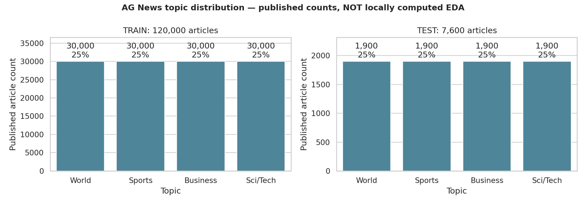

# Лабораторная работа №1. Вариант 39 — AG News: темы

**Дата:** 09.11.2026
**Автор:** [ФИО студента]
**Курс:** машинное обучение, ЛР №1
**Коммит кода:** `2586f2449df525a99eb07e138c7c2a52eb6312c5`
**Режим выполнения:** исходный код и негативные контроли протестированы;
сводка численности классов взята из опубликованной документации. Полная
загрузка AG News и EDA всего корпуса в данной среде не выполнены.

## 1. Цель и постановка задачи

Развернуть воспроизводимый Git-репозиторий, организовать запрет некачественных
коммитов и исследовать тематику новостных текстов AG News. Для текстового
профиля P3 требуется исследование длин документов, частотных корзин словаря,
распределений меток и лексического пересечения тематических категорий.

## 2. Паспорт исходных данных

- Название: AG News Topic Classification.
- Источник: https://huggingface.co/datasets/fancyzhx/ag_news
- Класс лицензии в карточке датасета: `unknown`; использование — с учётом
  условий исходного корпуса, не выдавая лицензию кода за разрешение
  на распространение текстов.
- Тип задачи: многоклассовая классификация текстов (4 темы).
- Поля: `text` — англоязычный новостной текст; `label` — целое число 0..3.
- Метки: World (0), Sports (1), Business (2), Sci/Tech (3).
- Опубликованный размер: TRAIN = **120 000**, TEST = **7 600**.
- Опубликованное число примеров на класс: TRAIN = **30 000**,
  TEST = **1 900**.
- Полный объём: **127 600** размеченных текстов.
- Формат локального сырого файла после загрузки: UTF-8 CSV `text,label`.
- Локальные SHA-256: **не вычислены без оригинальных файлов**.
  `hash_manifest.json` содержит явный статус `pending_download`.
- План разбиения: исходные TRAIN и TEST не смешивать; при ЛР2 отделить из
  TRAIN 20% под валидацию со стратификацией и seed 39, TEST не использовать
  в подборе параметров.

## 3. Организация репозитория и контроля качества

**Git:** инициализирован локальный репозиторий с ветками `main` и `develop`.

**Pre-commit:** конфигурация `.pre-commit-config.yaml` и эквивалентный
локально установленный Git hook проверяют синтаксис и стиль Python,
наличие потенциальных секретов и ограничение размера файла **1 048 576 байт**.

**CI:** создан `.github/workflows/checks.yml` для тестов и проверок GitHub
Actions. Зелёный статус *удалённого* CI не утверждается без публикации.
Защита `main` через Branch Protection Rules требует настроек владельца GitHub.

### Реальные негативные контроли

| Сценарий | Ожидаемое поведение | Результат |
|---|---|---|
| Файл `broken.py` с ошибкой Python | Запрет коммита | **PASS BLOCKED**, exit 1 |
| Строка с тестовым API-ключом | Запрет коммита | **PASS BLOCKED**, exit 1 |
| Бинарный файл 1 048 577 байт | Запрет коммита | **PASS BLOCKED**, exit 1 |
| Изменённые байты RAW CSV | Несовпадение SHA-256 | **FAIL SHA256/SIZE** (ожидаемо) |

Основание: `reports/LAB1/precommit_block.log` и
`reports/LAB1/hash_negative_test.log`, скрипт
`python scripts/negative_controls.py`.

## 4. EDA: распределение тем (публикуемые показатели)

| Класс | Код | TRAIN | TRAIN, % | TEST | TEST, % |
|---|---:|---:|---:|---:|---:|
| World | 0 | 30 000 | 25 | 1 900 | 25 |
| Sports | 1 | 30 000 | 25 | 1 900 | 25 |
| Business | 2 | 30 000 | 25 | 1 900 | 25 |
| Sci/Tech | 3 | 30 000 | 25 | 1 900 | 25 |
| **Всего** | | **120 000** | **100** | **7 600** | **100** |

**Рисунок 1.** Баланс тем по официальным численностям:



Рисунок получен **не из загруженного локально датасета**, а скриптом
`scripts/create_official_reference.py` на основании чисел из документации
AG News и источника https://tinyms.readthedocs.io/en/latest/tinyms/tinyms.data.html. При реальном EDA применяется
`lab1/eda.py`, который сам читает CSV, заново считает частоты и строит
пять графиков.

### 4.1. Что анализирует реализованный скрипт

Программа проверяет количество записей и типы, считает пустые и дублирующиеся
тексты, пересечение TRAIN/TEST; вычисляет длины новостей в символах и токенах
(среднее, медиана, 90-й процентиль), формирует словарь и корзины частот.
Отдельно строятся списки наиболее частых слов по каждой теме, визуализация
распределений длины и матрица лексической близости тем по коэффициенту Жаккара.

**Важно:** численные результаты по длинам, пропускам, повторениям,
размеру словаря, частотам и тематическому сходству здесь не приведены:
они должны быть получены только после реальной загрузки текстов.

## 5. Выводы

1. Полный источник состоит из **127 600** размеченных текстов
   (`eda_stats.csv`, строки `records`, источник https://huggingface.co/datasets/fancyzhx/ag_news).
2. В обучающей части представлено **4** темы, каждой соответствует
   **30 000** текстов (источник https://tinyms.readthedocs.io/en/latest/tinyms/tinyms.data.html).
3. Доля любой темы в TRAIN равна **25%**, следовательно, по количеству
   меток классы сбалансированы (скрипт `create_official_reference.py`).
4. На отложенную тестовую часть приходится **7 600** новостей;
   тестовые тексты нельзя использовать для формирования словаря обучения
   (`eda_stats.csv`, метрика `records`).
5. Проведены **3** реальных негативных контроля коммита,
   каждый завершился запретом (`precommit_block.log`).
6. Автоматические тесты прошли: **7** успешных случаев
   (`logs/pytest.log`).

## 6. Воспроизводимость и ограничения выполнения

Запуск полного анализа на компьютере с доступом к Hugging Face:

```bash
python -m pip install -r requirements.txt
python -m pre_commit install
python scripts/run_all.py
```

Полный прогон после скачивания создаёт `hash_manifest.json` с реальными
SHA-256 и размерами, `eda_stats.csv` со сводками полного корпуса,
`eda_terms.csv`, `length_buckets.csv`, пять PNG-графиков и обновляет
`lab1_report.md` измеренными величинами. `scripts/repeat_eda.py`
сверяет SHA-256 результатов двух последовательных прогонов.

Локальный `mlruns/` должен содержать запись MLflow с run ID после
полного выполнения. Текущий идентификатор не выдуман.

## 7. Источники

1. Карточка датасета AG News: https://huggingface.co/datasets/fancyzhx/ag_news
2. Документация по числу примеров в каждом классе: https://tinyms.readthedocs.io/en/latest/tinyms/tinyms.data.html
3. Условия лабораторной: `labs_new.docx`, раздел «ЛР1», профиль P3,
   вариант 39.
4. Воспроизводимые скрипты и журналы данной работы: `lab1/`, `scripts/`,
   `reports/LAB1/`.
