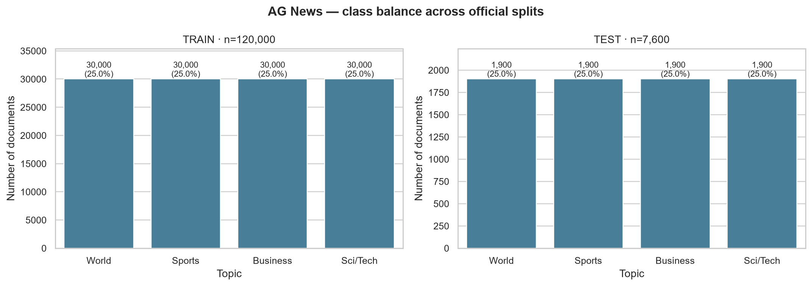
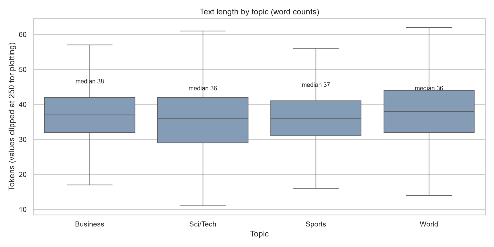
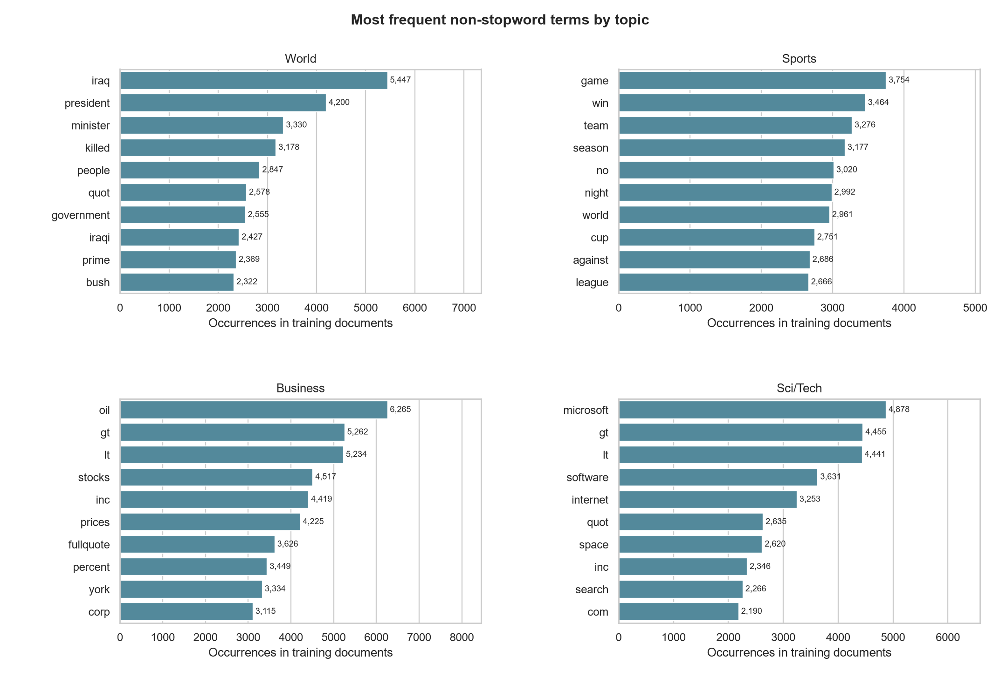
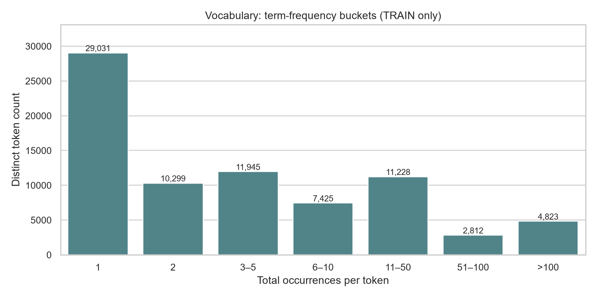
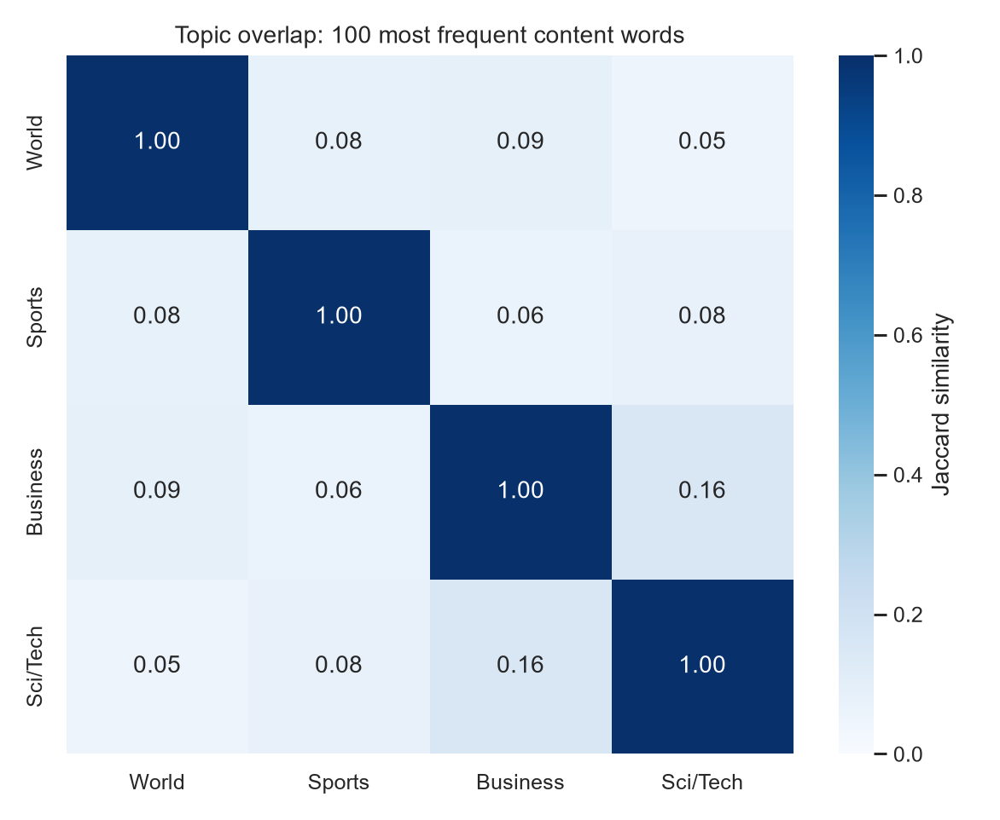

# Лабораторная работа №1 — вариант 39. AG News: темы

**Дата:** 23.11.2026
**Автор:** заполнить ФИО студента
**Вариант:** 39 (текстовый профиль P3)
**Коммит кода:** `40563724a4080dc889a46274eae45b883e384298`
**MLflow run ID:** `d986ae6f32b64849a154499cbf667e99`
**Статус:** EDA выполнен для данных из `data\raw`.

## 1. Цель

Развернуть Git-репозиторий с контролем качества коммитов и выполнить разведочный анализ
новостных текстов AG News с акцентом на распределение тем, длины текстов и словарь.

## 2. Паспорт данных

- **Источник:** https://huggingface.co/datasets/fancyzhx/ag_news (`fancyzhx/ag_news`).
- **Лицензия набора:** на странице Hugging Face указано `unknown`; перед внешним
  распространением текстов необходимо уточнить права оригинальных источников.
- **Состав:** поля `text` (строковый текст новости), `label` (целое 0—3).
- **Классы:** 0 World, 1 Sports, 2 Business, 3 Sci/Tech.
- **TRAIN:** 120,000 статей; **TEST:** 7,600 статей.
- **Хеш TRAIN (SHA-256):** `aa1eacef4c2c14b4d79ce593be6460b6bd25da42b08cbf78f84f4e9d1bcd444a`.
- **Хеш TEST (SHA-256):** `7f524a9977e1849efd8ba1c671a1d6dfa6c841026b62a4fb86b3a85d7ea41240`.
- **Манифест:** `reports/LAB1/hash_manifest.json`.
- **План разбиения для последующих работ:** исходный `test` не участвует в подборе
  параметров. На этапе ЛР2 из `train` выделяется воспроизводимая стратифицированная
  валидационная часть (например, 20% / seed=39); не смешивать с `test`.

## 3. Git и pre-commit

Настроены `.gitignore`, `.gitattributes`, шаблон pull request, локальный скрипт
проверок, `.pre-commit-config.yaml`, тесты и workflow CI. Блокируются Python-файлы
с ошибкой синтаксиса или стиля, строки с секретами и файлы размером свыше
1,048,576 байт. Репозиторий содержит `main` и `develop`.

Защита `main` на сервере GitHub настраивается владельцем репозитория: запретить прямые
push, потребовать pull request, минимум одно approval, обязательный успешный CI.
Локальный Git не может включить серверные Branch Protection Rules.

**Журнал негативных проверок:** `reports/LAB1/precommit_block.log`.

## 4. Разведочный анализ данных

**Распределение классов, TRAIN:** World: **30,000**; Sports: **30,000**; Business: **30,000**; Sci/Tech: **30,000**.

**Распределение классов, TEST:** World: **1,900**; Sports: **1,900**; Business: **1,900**; Sci/Tech: **1,900**.

**Структура и качество:** пустые тексты TRAIN = 0, TEST = 0;
повторяющиеся тексты TRAIN = 0, TEST = 0;
совпадений текстов между TRAIN и TEST = 0.

**Тексты и словарь:** медианная длина TRAIN = 37.0 слова,
90-й процентиль = 48.0; размер словаря (токены длиной ≥
2) = 77,563; доля токенов, встреченных один раз
(hapax), = 37.43%.

**Сходство тематической лексики:** максимальное Жаккарово сходство двух тем по
топ-100 тематических слов — 0.156
(Business / Sci/Tech). Это **лексическая близость**, а не фактическая
путаница предсказаний обученной модели.

### Графики

1. 
2. 
3. 
4. 
5. 

## 5. Выводы (каждый с числовым обоснованием)

1. Обучающая часть содержит **120,000** записей — объём позволяет оценивать
   частоты слов по темам (источник: `eda_stats.csv`, метрика `records`).
2. Медианная длина учебной новости составляет **37.0** слова —
   длины следует учитывать при выборе параметров токенизации.
3. Словарь по выбранному правилу нормализации содержит **77,563**
   уникальных токенов — частотные ограничения снизят разреженность TF-IDF.
4. **37.43%** типов слов встречаются всего один раз —
   это ограничивает пользу редких слов при обучении классической модели.
5. Лексическое сходство наиболее близких двух тем равно **0.156**
   — тематическую неоднозначность стоит проверить на ЛР2.

## 6. Воспроизводимость

- `eda_stats.csv` SHA-256: `cc2178e3dd54aacedd56cd20c5e9ae92c1706a3548c3aca90c2a22bfeb869465` (без изменений при повторе
  на тех же входных файлах и настройках).
- Графики и CSV строятся `python -m lab1.eda`.
- Манифест проверяется `python -m lab1.hashes verify`.
- Отказ на испорченном файле описан в `reports/LAB1/hash_negative_test.log`.
- Идентификатор MLflow — `d986ae6f32b64849a154499cbf667e99`; если указано `not_logged`, EDA запускали
  в явно отключенном режиме и необходимо повторить со включённым MLflow.

## 7. Ограничения

В исходных новостях могут встречаться HTML-сущности, редакционные дубли,
различающаяся длина текста и общие слова между темами. Наличие лексического
пересечения ещё не означает ошибки классификации: для оценки качества
потребуются модели и метрики следующих лабораторных.

## 8. Источники

- AG News dataset card: https://huggingface.co/datasets/fancyzhx/ag_news
- Zhang, Zhao, LeCun (2015), *Character-level Convolutional Networks for Text Classification*.
- Исходное задание: `labs_new.docx`, раздел «ЛР1» и вариант 39.

**Источник всех рассчитанных чисел:** `reports/LAB1/eda_stats.csv`, создаваемый
`lab1/eda.py`; графики строятся тем же скриптом. Временная заглушка не используется.
